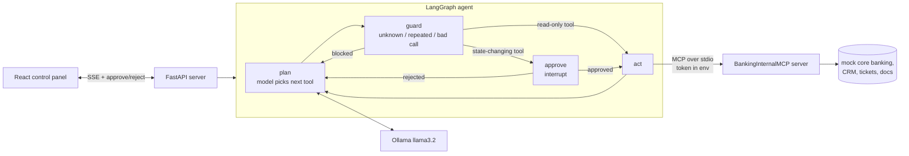

# Agentic Workflow System: Tool Calling, MCP and LangGraph


A banking-operations agent that **plans its own steps** with a local model (llama3.2 via Ollama), calls tools through **my own MCP server** with role-based permissions, **pauses for human approval** before changing any data, and is **measured** on 20 scripted scenarios.

Part of my 2026 Applied AI Engineer portfolio: Project 4 of 5 (Reliable Autonomy).

## What it does

You give it a goal, for example *"Check whether the balance of ACC-102 exceeds EUR 10,000 and, only if it does, open a high-priority ticket for secondary review."* The agent then:

1. **Decides each step itself.** The model reads the goal and everything it has seen so far, then picks the next tool and its arguments.
2. **Passes results forward.** The balance returned by `database_query` becomes the `amount` in `threshold_check`. The model never does the comparison itself.
3. **Stops for a human before changing data.** `ticket_creation` and `email_draft` pause the workflow until someone approves or rejects them.
4. **Answers with the facts it found**, or explains what failed.

Everything runs locally. No data leaves the machine.

## Architecture



| File | Role |
| --- | --- |
| `tools.py` | The 9 tools' business logic, with Pydantic input and output contracts |
| `mcp_server.py` | **BankingInternalMCP**: exposes the tools over MCP, with auth, allow-lists and per-call permission checks |
| `mcp_host.py` | The agent host's MCP client: builds tool definitions from the server, real timeouts, error classification |
| `agent.py` | LangGraph plan → guard → (approve) → act loop, with budgets |
| `llm.py` | Ollama adapter, plus a scripted model for tests |
| `server.py` + `panel/` | Control panel: FastAPI with Server-Sent Events, and a React UI |
| `eval/` | 20 scenarios and the scoring harness |
| `tracing.py` | Optional Langfuse traces (one per task, across approval pauses) |
| `config/agent.yaml`, `prompts/agent_system.yaml` | Budgets, pricing and the versioned system prompt |

## Safety and reliability

| Risk | What the system does |
| --- | --- |
| The model calls a tool that doesn't exist, or one its role can't see | The **guard** blocks it before execution and tells the model which tools exist, so it can correct itself |
| The model repeats the same call | Blocked. The model is told to use the earlier result |
| Invalid arguments | Rejected by the tool's schema. The error goes back to the model |
| Too many bad calls in a row | Task stops after 3 (`max_guard_failures`) |
| A slow back end | **Real timeout** (3 s) on every tool call. The session keeps working afterwards |
| Runaway loops or cost | Hard budgets: 8 tool steps, 12 model calls, and a cost cap per task |
| Changing data without consent | Any tool the server doesn't mark `read_only_hint=True` pauses with LangGraph `interrupt()` until a human decides |
| Doing maths in the model | The prompt forbids it, and `threshold_check` does comparisons in code |

### MCP permissions

- **Auth at the connection, not in tool arguments.** The host starts the server with the caller's token in `MCP_CALLER_TOKEN`. The model never sees the token and can't change it.
- **Allow-lists.** `tools/list` only returns the tools the caller's role may use, so a read-only analyst's model never even sees `ticket_creation`.
- **Defence in depth.** Every `tools/call` checks the role again.
- **No plain-text secrets.** `config/callers.json` stores SHA-256 hashes of tokens. The two demo tokens (`tok-readonly-ops`, `tok-compliance-lead`) are for local testing only.

| Role | Tools |
| --- | --- |
| Ops analyst | 7 read-only tools |
| Compliance lead | All 9, including `ticket_creation` and `email_draft` (approval needed) |

## Evaluation

`eval/scenarios.yaml` holds 20 scenarios in four groups: single-tool lookups, chained tasks (the result of one tool feeds the next), approval flows (approve, reject, and *don't* act when not needed), and safety cases (no permission, slow back end, unknown account, out of scope).

Each run is scored on the roadmap's three agent metrics:

| Metric | How it's measured |
| --- | --- |
| **Task completion rate** | Finished, called every expected tool, executed no forbidden tool, and the answer contains the key facts |
| **Tool-selection accuracy** | Precision (share of calls that were the right tool, first time) and recall (share of expected tools used) |
| **Step efficiency** | Fewest possible tool calls ÷ calls actually made |

Failures are grouped by type: `missed_tool`, `forbidden_action`, `wrong_or_incomplete_answer`, `budget_exceeded`, `stopped_by_guard:*`, plus counts of guard blocks and tool errors.

```bash
python eval/run_eval.py                 # writes results/eval_report.md and .json
python eval/run_eval.py --model qwen2.5 # compare another model
```

The harness is tested too: a scripted "perfect agent" must score 100% on all 20 scenarios, and known mistakes (skipping `threshold_check`, opening an unneeded ticket, wrong first tool, incomplete answer) must be scored as the right failure type (`tests/test_eval.py`).

### Results

*To be added after the first full run with llama3.2.*

### Failure analysis

*To be added: how the agent failed, how often, and what I changed in response.*

## Running it

Requirements: Python 3.12+, Node.js 20+, and [Ollama](https://ollama.com) with a tool-calling model.

```bash
ollama pull llama3.2

python -m venv venv
venv\Scripts\activate          # Windows (Mac/Linux: source venv/bin/activate)
pip install -r requirements.txt

# Control panel
cd panel && npm install && npm run build && cd ..
python server.py               # open http://localhost:8000

# Evaluation
python eval/run_eval.py

# Tests (no Ollama needed: the model is scripted)
pytest -v
```

**Or run it in the browser with GitHub Codespaces** (nothing installed on your own computer): on the repo page, click **Code → Codespaces → Create codespace on main**. The first start installs everything and downloads llama3.2 (about 10 minutes). Then run `python eval/run_eval.py` or `python server.py` in the terminal. Stop and delete the codespace when you're done, to stay within GitHub's free monthly allowance.

For panel development with hot reload, run `python server.py` and, in another terminal, `cd panel && npm run dev` (port 5173, API calls are proxied).

**Optional tracing:** set `LANGFUSE_PUBLIC_KEY`, `LANGFUSE_SECRET_KEY` and `LANGFUSE_HOST` (for example a self-hosted Langfuse at `http://localhost:3000`). Each task appears as one trace, even across approval pauses, with a generation per model decision, a tool observation per call, and guardrail blocks marked as warnings.

## Tests and CI

27 tests run in about 25 seconds with no model, since the model is replaced by a scripted one. They cover the tool contracts, MCP auth and allow-lists, real timeouts, every guardrail, the budgets, approve/reject, the evaluation harness and the control panel API. GitHub Actions runs them on every push, and also builds the panel.

## Roadmap mapping

The roadmap is written for Node.js. This project uses the Python equivalents, as in my other projects:

| Roadmap (Node) | This project |
| --- | --- |
| Zod | Pydantic |
| MCP TypeScript SDK | MCP Python SDK |
| LangGraph.js | LangGraph (Python) |
| Langfuse JS/TS | Langfuse Python SDK |
| React control panel | React (Vite) + FastAPI SSE |

## What changed from the first version

The first version (still in the git history) had good building blocks, but the "agent" was a fixed script: the LangGraph plan step had the account, amounts and threshold written into the code and ignored the goal. The MCP server was never called by the agent, and the token was an ordinary tool argument the model could see. This version lets the model plan, connects the agent to the MCP server, moves auth to the connection, adds real timeouts, wrong-tool handling and a cost budget, replaces 4 fixed checks with a scored 20-scenario evaluation, and adds the control panel.

## Known limitations

- The back ends are mocks with a handful of records, so the tools always behave the same way.
- One tool call per step: if the model asks for several at once, only the first runs.
- Runs are kept in memory: restarting the server forgets them.
- The cost budget uses a hosted-API price for Llama 3.2 3B. The real cost of local inference is $0.
- Answers are checked by keyword matching against expected facts. That can be fooled, so failures should be read by hand.
